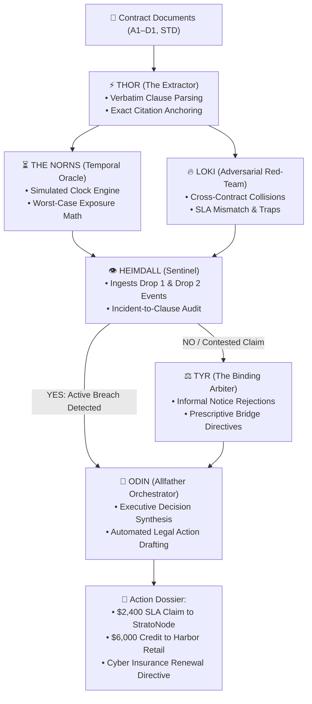

# Team Coffee ☕ — Odin: The Contract War Room

> **TantraFiesta '26 | IIIT Nagpur — RAGNAROK Hackathon**  
> **Track 2:** *Odin: A Multi-Agent Contract Intelligence System for Risk Foresight*  
> **Target Enterprise:** *Quillhub Inc. (Austin, TX — Route Optimization B2B SaaS)*

[](https://fastapi.tiangolo.com)
[](https://react.dev)
[](https://www.typescriptlang.org)
[](https://vitejs.dev)
[](https://opensource.org/licenses/MIT)

---

## 👥 The Team
* **KIller13b** ([@KIller13b](https://github.com/KIller13b))
* **Devansh Bhasme** ([@devanshbhasme](https://github.com/devanshbhasme))
* **Aryan25875** ([@Aryan25875](https://github.com/Aryan25875))

---

## 📖 Executive Summary
Enterprise organizations manage hundreds of interconnected, asynchronous commercial agreements (cloud compute vendors, enterprise clients, subcontracting SOWs, and DPAs). Hidden liabilities, contradictory SLAs, auto-renewals with narrow notice windows, and deeming traps regularly trigger catastrophic exposure before legal ops even notice.

**Odin** is an autonomous Norse-themed multi-agent contract war room engineered for **zero-hallucination legal intelligence**:
1. **Verbatim Grounding:** 100% substring-verified citations anchored to raw contract files.
2. **Temporal Foresight:** Dynamic timeline engine simulating legal exposure across shifting clock dates (`2027-01-15`, `2027-03-15`, `2027-06-01`, `2027-09-15`).
3. **Adversarial Red-Teaming:** Hostile opposing counsel simulation exposing cross-contract traps.
4. **Sentinel Correlation:** Live operational event correlation mapping cloud outages and payment ledgers to clause breaches.
5. **Binding Arbitration & Action Drafting:** Formal dispute resolution and ready-to-issue cure notices and SLA refund claims.

---

## 🏛️ Multi-Agent Architecture



### The 6 Norse Agent Roles
| Agent | Mythological Title | Core Role in System | Key Output |
| :--- | :--- | :--- | :--- |
| **👑 Odin** | *The Allfather* | High-level synthesis, strategic prioritization, executive notice generation | Final Action Dossiers, CURE_NOTICE, SLA_CREDIT_CLAIM |
| **⚡ Thor** | *The Extractor* | OCR clause segmentation, 100% verbatim quotes, zero hallucination enforcement | Verified Clause Citations, Anchor Verification |
| **⏳ The Norns** | *The Timekeepers* | Dynamic timeline scrubber, countdown tracking, exposure math | `upcoming_deadlines_30d`, Simulated Clock Projections |
| **🔥 Loki** | *The Red-Team Counsel* | Hostile opposing review, legal traps, cross-contract collisions | Adversarial Hypotheses, Collision Sentinel |
| **👁️ Heimdall** | *The Sentinel* | Ingests real-world telemetry (`events_drop1/2.jsonl`, payments) | Incident-to-Clause Correlation, YES/NO Validation |
| **⚖️ Tyr** | *The Binding Arbiter* | Dispute adjudication, dismissing invalid claims, bridge agreements | Legal Rulings, Informal Notice Rejections |

---

## 🔍 Critical Findings on Quillhub Inc.

Our autonomous agents discovered 4 critical cross-contract traps in Quillhub's commercial portfolio:

### 1. The 40x SLA Upstream/Downstream Mismatch
* **Upstream (`A2 §2.1`):** StratoNode commits only to **99.5%** uptime ($8k/mo fee).
* **Downstream (`B1 §3.1`):** Harbor Retail mandates **99.9%** uptime ($40k/mo fee).
* **The Collision:** On March 3, 2027, a 190-minute outage occurred (Event `E-04`/`E-05`). StratoNode achieved 99.57% (no breach; owes $0). However, Harbor Retail experienced 99.57% (< 99.9% required), triggering a 15% billing credit ($6,000) Quillhub must absorb with zero upstream recourse.

### 2. The 15-Day SLA Credit Forfeiture Window (`A3 §1`)
* Amendment No. 1 (`A3`) shortened the SLA credit claim window to **15 days after calendar month-end**.
* On May 1–2, 2027, StratoNode suffered a massive 505-minute outage (Event `E-12`/`E-13`), dropping monthly uptime to 98.83% and entitling Quillhub to a 30% credit (**$2,400**).
* **Odin's Action:** Dispatched formal `SLA_CREDIT_CLAIM` prior to June 15, 2027, preventing permanent waiver.

### 3. Subcontractor Deemed Acceptance Trap (`D1 §4.2`, `§4.3`)
* Pixelwright delivered Milestone M3 on Feb 28, 2027 (`E-03`).
* Under Section 4.3, failure to serve a formal written rejection within 10 business days deems the deliverable accepted.
* Because engineering did not serve formal rejection by March 12, M3 was deemed accepted by operation of law, obligating a **$20,000 disbursement**.

### 4. Cyber Insurance Expiry Trap (`B1 §7.2`)
* Meridian Mutual cyber policy expires **June 30, 2027**.
* Harbor Retail Agreement (`B1 §7.2`) stipulates that a lapse in cyber coverage ($3M requirement) constitutes a **material breach without cure**, granting Harbor immediate unilateral termination rights.
* **Tyr's Ruling:** Mandated formal renewal binder execution prior to June 25, 2027.

---

## ⚡ Quick Start Guide

### 1. Prerequisites
- **Node.js** v18+ & **npm**
- **Python** 3.10+ & **pip**

### 2. Repository Setup
```bash
git clone https://github.com/KIller13b/team-coffee.git
cd team-coffee
```

### 3. Backend Setup (FastAPI)
```bash
cd backend
python3 -m venv .venv
source .venv/bin/activate
pip install -r requirements.txt

# Start backend server on port 8000
uvicorn app.main:app --host 0.0.0.0 --port 8000
```

### 4. Frontend Setup (React + Vite + Tailwind)
In a separate terminal:
```bash
cd frontend
npm install
npm run dev -- --host 0.0.0.0 --port 5173
```
Open **[http://localhost:5173](http://localhost:5173)** in your browser!

---

## 🧪 Verification & CLI Testing

### Run Multi-Agent War Room Engine:
```bash
cd team-coffee
PYTHONPATH=backend python3 -c "
from app.agents import ContractWarRoomWorkflow, load_dataset_bundle
workflow = ContractWarRoomWorkflow()
bundle = load_dataset_bundle('odin_data/bundle')
result = workflow.execute('A1', bundle['contracts']['A1'], bundle['events'], clock_date='2027-03-15')
print('=== ODIN MULTI-AGENT EXECUTION SUMMARY ===')
print(f'Contract: {result[\"thor\"][\"title\"]}')
print(f'Norns Deadlines: {len(result[\"norns\"][\"upcoming_deadlines_30d\"])}')
print(f'Loki Red-Team Claims: {len(result[\"loki\"][\"risks_and_claims\"])}')
print(f'Heimdall Audited Incidents: {len(result[\"heimdall\"][\"audited_incidents\"])}')
print(f'Odin Final Actions: {len(result[\"final_actions\"])}')
for action in result[\"final_actions\"]:
    print(f'  -> [{action.action_type}] {action.title} (Party: {action.recipient_party})')
"
```

### Test Loki Adversarial Red-Team Scan:
```bash
curl -s -X POST http://localhost:8000/api/chat \
  -H "Content-Type: application/json" \
  -d '{"agent_id": "loki", "message": "Audit StratoNode A2 and Harbor Retail B1 for uptime mismatch."}'
```

### Check Canonical Contract Indexing:
```bash
curl -s http://localhost:8000/api/contracts | grep -o '"title":"[^"]*"'
```

---

## 🌐 API Reference

| Endpoint | Method | Description |
| :--- | :--- | :--- |
| `/api/contracts` | `GET`, `POST` | Fetches indexed contracts or uploads new PDF/TXT documents |
| `/api/contracts/{id}` | `GET` | Returns full clause segmentation, verbatim quotes, and obligations |
| `/api/risks` | `GET` | Cross-contract collision registry and severity classification |
| `/api/agents` | `GET` | Live telemetry status for all 6 Norse agents |
| `/api/agents/messages` | `GET` | Real-time agent debate messages and cross-agent consensus log |
| `/api/timeline/events` | `GET` | Chronological milestone timeline across simulated checkpoints |
| `/api/events/external` | `GET` | Operational event logs ingested from `events_drop1/2.jsonl` |
| `/api/reports` | `GET` | Executive audit dossiers and prioritized mitigation directives |
| `/api/workflow/run` | `POST` | Executes complete topological multi-agent pipeline |
| `/api/chat` | `POST` | Interactive real-time chat with Odin, Loki, Thor, Norns, Heimdall, or Tyr |

---

## 🛡️ Non-Functional Requirements & Design Principles

* **Zero Hallucination (NFR2):** Any clause citation or quote displayed in the war room is verified via strict substring matching against canonical `.txt` files in `odin_data/bundle/contracts/`.
* **Zero Token Burn Fallback:** Full rule-based and regex engine runs offline without external APIs. High-speed LLM dialogue is optionally powered by Groq (`qwen/qwen3.8-27b`) with zero credit cost.
* **Asynchronous Consensus:** Independent agents communicate via standardized schema buses (`ThorOutput`, `NornsOutput`, `LokiOutput`, `HeimdallOutput`, `TyrOutput`, `OdinFinalAction`).
* **Continuous Build Readiness:** Strict TypeScript compilation (`npm run build`) and clean git branching maintained throughout evaluation.

---

<div align="center">
  <sub>Built with ☕ and honor by <strong>Team Coffee</strong> for TantraFiesta '26 RAGNAROK Hackathon.</sub>
</div>
