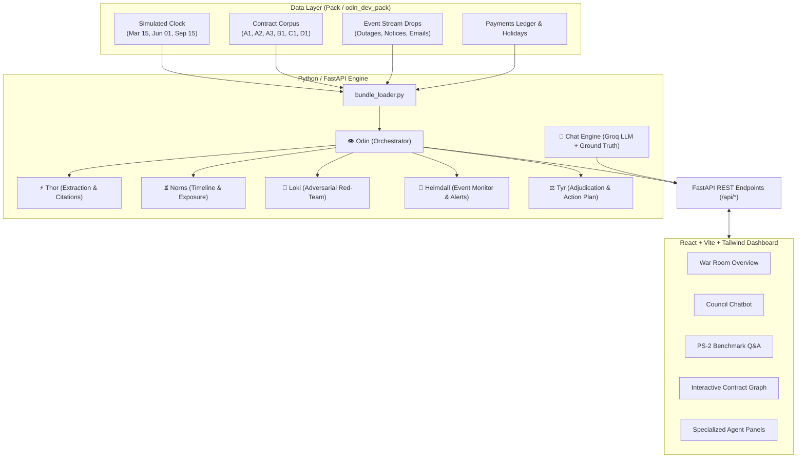

# 🛡️ Odin — Multi-Agent Contract Intelligence War Room

> **Autonomous multi-agent contract intelligence and risk adjudication system for Quillhub Inc., engineered for the Ragnarok PS-2 Contract Intelligence Challenge.**

---

## 📌 Table of Contents

- [Overview](#-overview)
- [System Architecture](#-system-architecture)
- [The Agent Council](#-the-agent-council)
- [PS-2 Benchmark Solutions](#-ps-2-benchmark-solutions)
  - [Question 1: Non-Outage Defaults & Material Breaches](#question-1-non-outage-defaults--material-breaches)
  - [Question 2: March 3 Outage SLA & Financial Recovery Gap](#question-2-march-3-outage-sla--financial-recovery-gap)
- [Key Features](#-key-features)
- [Tech Stack](#-tech-stack)
- [Repository Structure](#-repository-structure)
- [Getting Started](#-getting-started)
  - [Prerequisites](#prerequisites)
  - [Backend Setup (Python / FastAPI)](#backend-setup-python--fastapi)
  - [Frontend Setup (React / Vite)](#frontend-setup-react--vite)
- [API Reference](#-api-reference)
- [Environment Variables](#-environment-variables)

---

## 🔍 Overview

**Odin** is a multi-agent contract intelligence engine and command war room designed to ingest complex legal contracts, time-stamped business event drops, payment ledgers, and holiday calendars. It identifies contractual loopholes, monitors SLA breaches, tracks cross-contract exposure, and formulates strategic legal and operational remedies in real time across simulated clock checkpoints.

### Key Objectives
- **Strict Grounding:** Every legal claim and extracted term is tied to exact clause references and verifiable verbatim text quotations.
- **Cross-Contract Topology:** Resolves conflicting clauses across vendors (upstream infrastructure) and clients (downstream enterprise licenses).
- **Proactive Adjudication:** Red-teams counterparty maneuvers, generates enforceable legal notices, and safeguards Quillhub against unrecoverable financial losses.

---

## 🏛️ System Architecture



---

## 👥 The Agent Council

The system leverages specialized autonomous agents inspired by Norse mythology, each owning a distinct analytical domain:

| Agent | Mythological Persona | Operational Role & Capabilities |
| :--- | :--- | :--- |
| **👁️ Odin** | Allfather & Orchestrator | Coordinates multi-agent workstreams (`WS-A` to `WS-X`), tracks consensus loops, maintains the audit log, and synthesizes overall company risk. |
| **⚡ Thor** | God of Strength & Truth | Extracts structured terms (parties, renewal dates, SLA uptime thresholds, exclusivity clauses) grounded by strict verbatim string verification (`verify_citation`). |
| **⏳ Norns** | Weavers of Fate & Time | Analyzes timeline deadlines, calculates cure windows, tracks SLA claim expiry dates, and projects worst-case cumulative financial liability. |
| **🐍 Loki** | God of Mischief & Deception | Adversarial red-teaming agent that uncovers counterparty breach vectors, hidden default triggers, territorial conflicts, and insurance lapses. |
| **📯 Heimdall** | The Watcher of the Bifröst | Watches real-time event drops (`events_drop1.jsonl`, `events_drop2.jsonl`), correlates incidents against contract terms, and triggers active breach alerts. |
| **⚖️ Tyr** | God of Law & Justice | Formulates binding legal rulings, drafts formal breach responses, generates SLA rejection letters for untimely claims, and recommends settlement strategies. |

---

## 🎯 PS-2 Benchmark Solutions

Odin provides pre-computed, rigorously cited solutions for the benchmark challenges directly in the dashboard and via dedicated API endpoints:

### Question 1: Non-Outage Defaults & Material Breaches
**Query:** *Is Quillhub currently in default or material breach of any terms in the Harbor Retail agreement (B1), unrelated to service outages?*

- **Findings:**
  1. **Imminent Insurance Coverage Lapse (`B1 §7.1 / §7.2 / §8.2`):**
     - Quillhub's Meridian Mutual policies (`MML-2024-88714` and `MML-2024-88715`) expire on **June 30, 2027**.
     - B1 §7.1 mandates continuous coverage through September 2029; B1 §7.2 stipulates any lapse constitutes an automatic **material breach** permitting immediate termination upon 15 days' notice.
  2. **Missed 4-Hour Incident Notification Deadline (`B1 §4.1`):**
     - Outage occurred on March 3 at 10:05 UTC. Notice (`E-05`) was sent March 4 at 14:30 UTC (>28 hours late), violating the 4-hour window.
  3. **Failure to Deliver Written RCA (`B1 §4.2`):**
     - Quillhub failed to deliver a written Root Cause Analysis within 5 business days following service restoration.
  4. **Territorial Exclusivity Conflict (`B1 §6.1` vs `C1 §4.1`):**
     - B1 grants Harbor exclusivity across retail grocery in WA/OR. C1 grants Vantage Logistics PNW tier-wide exclusivity, risking concurrent breach.

### Question 2: March 3 Outage SLA & Financial Recovery Gap
**Query:** *March 3, 2027 outage uptime %, customer credits owed, and upstream recovery from StratoNode.*

- **Calculations:**
  - **March 2027 Total Time:** $31 \text{ days} \times 24 \text{ hrs} \times 60 \text{ min} = 44,640 \text{ minutes}$
  - **Downtime:** 190 minutes (10:05 UTC to 13:15 UTC)
  - **Monthly Uptime:** $\frac{44,640 - 190}{44,640} \times 100 = \mathbf{99.5744\%}$
- **Downstream Liability (Harbor Retail - B1):**
  - **Target:** 99.9% $\rightarrow$ **Breached** (99.5744% < 99.9%).
  - **Credit Rate:** 15% of Monthly Fee ($40,000) = **$6,000.00**.
  - **Defense Angle:** Harbor submitted its credit request (`E-17`) on June 15, missing the mandatory May 15 deadline (`B1 §3.5`). Quillhub can legally reject the claim.
- **Upstream Recovery (StratoNode - A2/A3):**
  - **Target:** 99.5% $\rightarrow$ **Not Breached** (99.5744% > 99.5%). StratoNode delivered above its contractual commitment.
  - **Bonus Credit Window:** A3 §2 $400 bonus claim expired April 15, 2027 without a claim filed.
  - **Recoverable:** **$0.00**.
- **Structural Contractual Mismatch:**
  - Downstream commitment (99.9%) exceeded upstream guarantee (99.5%), creating a **net unrecoverable financial gap of $6,000.00**.

---

## 🚀 Key Features

- **War Room Dashboard:** Executive cockpit displaying real-time compliance status, active alerts, risk exposure gauges, and checkpoint selectors.
- **Council Chatbot:** Interactive multi-agent conversational interface powered by Groq LLM with deterministic ground-truth legal citations.
- **Interactive Contract Graph:** Force-directed network diagram (`vis-network`) illustrating agreements, relationships, dependencies, and risk hubs.
- **Agent Logs & Audit Trail:** Full chronological visibility into inter-agent communication, consensus loops, and reasoning steps.
- **Autonomous Action Generator:** Automated drafting of legal notices, cure notifications, and credit denial communications ready for review.

---

## 🛠️ Tech Stack

### Backend
- **Python 3.10+**
- **FastAPI**: Asynchronous high-performance REST API
- **Uvicorn**: Lightning-fast ASGI web server
- **Pydantic v2**: Strict schema validation and serialisation
- **Requests**: External LLM inference client

### Frontend
- **React 18**: UI component architecture
- **Vite**: Modern front-end tooling and development server
- **Tailwind CSS**: High-density military / cyberpunk war room styling
- **Zustand**: Fast and scalable state management
- **Vis-network**: Dynamic interactive network visualization
- **Lucide React**: Clean, modern iconography

---

## 📂 Repository Structure

```text
odin/
├── README.md                      # Complete system documentation
├── backend/                       # Python / FastAPI backend
│   ├── requirements.txt           # Python dependencies
│   ├── __init__.py
│   ├── agents/                    # Multi-agent persona implementations
│   │   ├── __init__.py
│   │   ├── odin.py                # Allfather orchestrator (FR1)
│   │   ├── thor.py                # Legal extraction & citations (FR2)
│   │   ├── norns.py               # Timeline & financial exposure (FR3)
│   │   ├── loki.py                # Adversarial red-team analysis (FR4)
│   │   ├── heimdall.py            # Event monitoring & alerts (FR5)
│   │   └── tyr.py                 # Legal rulings & actions (FR6)
│   ├── api/                       # API routes & engine
│   │   ├── __init__.py
│   │   ├── main.py                # FastAPI endpoints & benchmark routes
│   │   └── chat_engine.py         # Council interactive chatbot engine
│   ├── state/                     # Shared memory & Pydantic models
│   │   ├── __init__.py
│   │   └── schema.py              # Schema definitions (OdinState, Citations, etc.)
│   └── tools/                     # Data ingestion & loaders
│       ├── __init__.py
│       └── bundle_loader.py       # Reads contract bundle, clock, events, ledger
└── frontend/                      # React / Vite frontend
    ├── index.html                 # App shell
    ├── package.json               # Node dependencies and scripts
    ├── vite.config.js             # Vite config with API proxy
    ├── tailwind.config.js         # War room custom styling tokens
    └── src/
        ├── App.jsx                # Main layout and tab router
        ├── main.jsx               # React entry point
        ├── index.css              # Custom utility styles and theme
        ├── stores/
        │   └── warRoomStore.js    # Global Zustand store
        └── components/            # UI Panels (Overview, Benchmark, Chat, Graph, etc.)
```

---

## 💻 Getting Started

> [!NOTE]
> The project consists of a **Python FastAPI backend** and a **React/Vite frontend**. Please ensure you run each in its respective environment.

### Prerequisites
- **Python 3.10+**
- **Node.js 18+** and **npm**

---

### Backend Setup (Python / FastAPI)

1. Open your terminal and navigate to the project directory:
   ```bash
   cd /path/to/odin
   ```

2. Activate the virtual environment (created at `.venv`):
   ```bash
   source .venv/bin/activate
   ```
   *(Or if creating fresh: `python3 -m venv .venv && source .venv/bin/activate`)*

3. Install the required Python dependencies:
   ```bash
   pip install -r backend/requirements.txt
   ```

4. Launch the FastAPI server:
   ```bash
   python3 -m uvicorn backend.api.main:app --host 0.0.0.0 --port 8000 --reload
   ```

   The backend will be live at `http://localhost:8000` (Swagger docs available at `http://localhost:8000/docs`).

---

### Frontend Setup (React / Vite)

1. In a separate terminal tab, navigate to the `frontend` folder:
   ```bash
   cd /path/to/odin/frontend
   ```

2. Install dependencies:
   ```bash
   npm install
   ```

3. Start the development server:
   ```bash
   npm run dev
   ```

4. Open your browser and access the War Room at:
   ```
   http://localhost:5173
   ```

---

## 📡 API Reference

| Method | Endpoint | Description |
| :--- | :--- | :--- |
| `GET` | `/` | API status and greeting |
| `GET` | `/health` | Server health check |
| `POST` | `/api/run` | Triggers the complete multi-agent pipeline for a checkpoint |
| `GET` | `/api/state/{idx}` | Retrieves cached analysis state for checkpoint index |
| `GET` | `/api/checkpoints` | Returns simulated clock checkpoints and active dates |
| `GET` | `/api/contracts` | Fetches contract metadata and manifest |
| `GET` | `/api/events` | Retrieves all chronological events or specific drops |
| `GET` | `/api/ledger` | Returns payment ledger records |
| `GET` | `/api/timeline/{idx}` | Returns Norns projected timeline and exposure |
| `GET` | `/api/attacks` | Runs Loki red-teaming analysis |
| `GET` | `/api/events/analysis` | Runs Heimdall event monitoring and alert generator |
| `GET` | `/api/actions` | Generates Tyr's legal rulings and drafted actions |
| `POST` | `/api/chat` | Natural language chatbot querying the Agent Council |
| `GET` | `/api/benchmark/q1` | Solves PS-2 Question 1 (Non-outage defaults & breaches) |
| `GET` | `/api/benchmark/q2` | Solves PS-2 Question 2 (March 3 outage SLA & recovery) |

---

## 🔑 Environment Variables

To enable real-time Groq LLM reasoning in the **Council Chatbot** (fallback deterministic ground truth works without any API keys), create a `.env` file in the project root:

```env
GROQ_API_KEY=gsk_your_groq_api_key_here
GROQ_MODEL=qwen/qwen3.8-27b
```

---

## 🏆 Authors

**Team Ragnarok / Odin Council** — Built with precision for the Ragnarok Contract Intelligence PS-2 Challenge.
